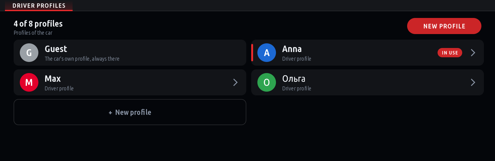
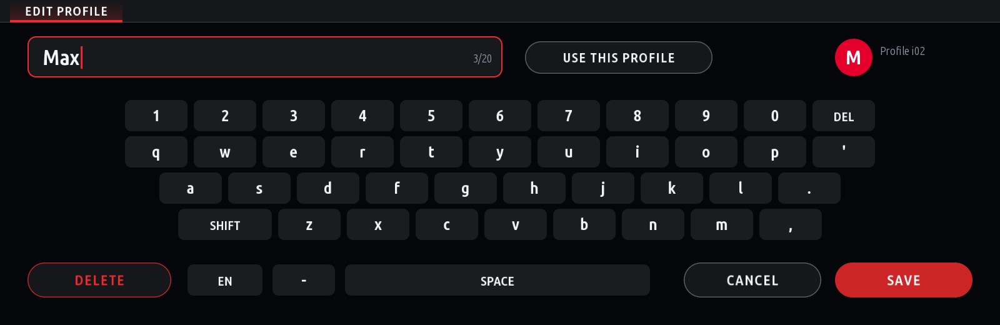
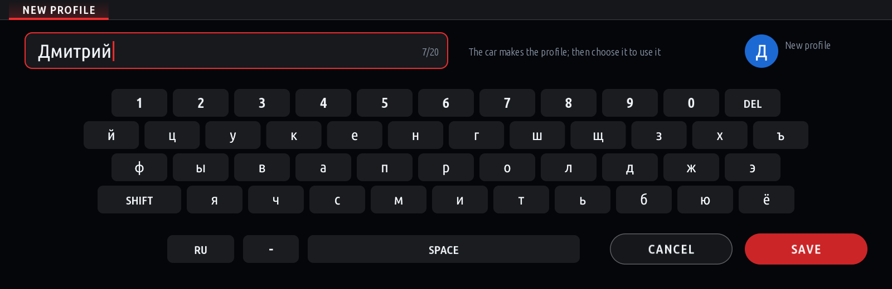

# BMW apps

<p align="center">
  <b>Custom apps for the BMW MGU head unit (iDrive 7)</b>, built with the kit of
  <a href="https://github.com/cauliflowermossgrape/idrive7-apps">cauliflowermossgrape/idrive7-apps</a>
  and readable as a source by the <a href="https://github.com/robertnisipeanu/mgu-store">MGU Store</a>.
</p>

<p align="center">
  
</p>

> **Disclaimer.** This is an unofficial hobby project. It is not affiliated with, endorsed by or supported by BMW AG.
> You modify your own head unit at your own risk.

## Apps

| App | What it does |
|---|---|
| [**Driver profiles**](apps/glnulled_driver_profiles/README.md) (`glnulled_driver_profiles`) | The car's own driver profiles without BMW ID / ConnectedDrive: the list with the profile in use, new profiles with a name typed on an English or Russian keyboard, rename, switch, delete one |

| | |
|---|---|
| <br>A profile: rename, Use this profile, Delete | <br>A new profile on the Russian keyboard |

## Install from the MGU Store

In the Store on the car: Settings → **Add source** → `glnulled/bmw-apps`, then pick a branch (`main`). `mgu-repo.json`
at the root makes it a *repo tree* source: the head unit builds every app in `apps/` from source with the kit in
this repository, using the BMW SDK already on the unit, so no SDK and no built package is published here. The apps
need a renderer (`"needs": ["renderer"]`): the Store's own mgu-render, or idrive7-apps' GPU renderer.

## Build and install by hand

As in idrive7-apps (its [Quick start](https://github.com/cauliflowermossgrape/idrive7-apps#3-quick-start) has the
details): Python 3.6+, Node.js 14+, root access to the head unit, and BMW's SDK extracted from your own unit.

```sh
# BMW's SDK, from your own unit (never commit it)
scp root@<unit>:'/usr/lib/oap-mainapp/preinstalled_apps/x_call@*.tgz' .
mkdir x_call && tar xzf x_call@*.tgz -C x_call
node kit/tools/extract_sdk.js x_call/javascript/app.js        # -> ./oap-sdk/

npm test                                                       # the tests (no SDK or car needed)
python3 kit/tools/build.py glnulled_driver_profiles            # -> dist/<id>@<version>.mgu and .tgz
node kit/tools/emu.js glnulled_driver_profiles                 # live emulator: http://localhost:8077
deploy/make-car-kit.sh && HU=root@<unit> KEY=<ssh key> deploy/push-to-car.sh install
```

To check an app's SOME/IP interfaces against your car, copy the unit's catalog to `reference/`
(`scp root@<unit>:/etc/oap/someip/someip-interfaces.json reference/`) and run `python3 kit/tools/check_signals.py`.

`oap-sdk/`, `reference/` and `dist/` stay out of git: the SDK and every built package contain BMW's code.

## Repository layout

```
apps/<id>/            one app: app.json, main.js and its modules, README.md
kit/runtime/          the apps' runtime: platform glue, drawing, SOME/IP, fonts, themes
kit/tools/            build.py, emu.js (emulator), make_kit.py, check_signals.py, sigdoc.py, tests (test_*.js)
kit/renderd/          the GPU renderer (prebuilt/: the ready binary), GPL-3.0-or-later
kit/emu/              the emulator's page and draw engine (WebAssembly)
kit/localization/     glyph atlases (Cyrillic, Korean, Chinese) and translation credits
deploy/               packing the car kit and installing it over SSH
docs/screens/         screenshots (kit/tools/screens_<id>.js draws them)
mgu-repo.json         this repository as an MGU Store source
```

## Adding an app

1. `apps/<prefix>_<name>/` with `app.json` and `main.js` (format and API: section 6 of the idrive7-apps README,
   [Writing your own app](https://github.com/cauliflowermossgrape/idrive7-apps#6-writing-your-own-app)). Ids here
   start with `glnulled_`: app ids are global on the head unit.
2. A `loggingId` of its own (4 characters): `GL00` is Driver profiles, the next one `GL01`.
3. SOME/IP interfaces in `app.json` → `signals`, checked with `python3 kit/tools/check_signals.py`.
4. A test, `kit/tools/test_<id>.js` (`npm test` runs it), a `README.md` in the app's folder, a line in the table
   above and in `CHANGELOG.md`.

`mgu-repo.json` lists `apps/*`, so the Store offers a new app as soon as it is on the branch.

## The kit

`kit/` and `deploy/` come from idrive7-apps at `8681f50` (renderer 2.1.11), without its apps and their tests; the
changes made here are listed in [CHANGELOG.md](CHANGELOG.md). To take a newer kit, copy its `kit/` and `deploy/` over
these and keep those changes.

## License

MIT ([LICENSE](LICENSE)), as idrive7-apps. The parts with licences of their own keep them: the GPU renderer
`kit/renderd` and the emulator's draw engine (`kit/emu/wasm`, `kit/emu/web/gfx`) are GPL-3.0-or-later
([kit/renderd/LICENSE](kit/renderd/LICENSE)); the kit's Chinese translation is credited in
[NOTICE.zh-CN.md](NOTICE.zh-CN.md); fonts carry their OFL licences beside them.
