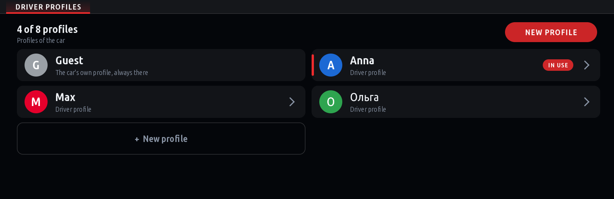
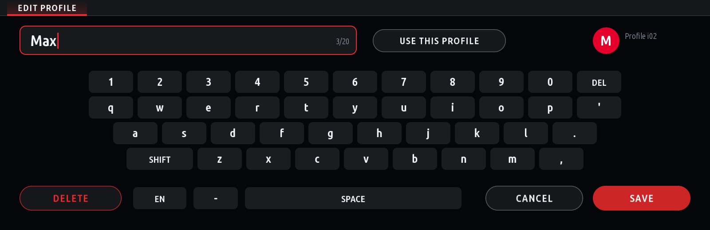
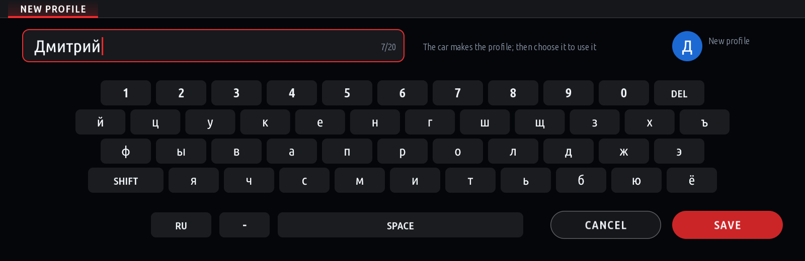

# Driver profiles

The car's own driver profiles on iDrive 7 (MGU), without BMW ID or ConnectedDrive: the same profiles as in the car's
Driver profiles menu, made, renamed and deleted from the app. Id `glnulled_driver_profiles`.

<p align="center">
  
</p>

## What it does

- **The list:** Guest and the car's profiles (up to 7). The one in use has a stripe on the left and **IN USE**.
- **New profile:** type the name on the on-screen keyboard (touch or the iDrive controller), then **Save**: the car
  makes the profile with that name at once, and it shows in the car's menu.
- **A profile** (tap its card):
  - rename it: a new name and **Save**;
  - **Use this profile**: the car switches to it;
  - **Delete**: removes just this profile, on the second press (the first turns the button into Confirm for 5 s).
- **Guest:** a tap switches the car to Guest; Guest itself can't be changed or deleted.
- **Keyboard:** English and Russian (ЙЦУКЕН) layouts; the key left of the space bar steps through them. Each can be
  switched off in the app's settings (*English keyboard*, *Russian keyboard*). A word starts with a capital by
  itself. Names have up to 20 characters.

To recognise a driver by key: choose the profile in the car's menu and turn on driver recognition there, as for
any profile.

| | |
|---|---|
| <br>A profile: rename, use, delete | <br>A new profile on the Russian keyboard |

## How it works

The app uses the head unit's personalisation services over SOME/IP, the ones the car's own menu uses (`car.js`;
interfaces from the unit's catalog, `/etc/oap/someip/someip-interfaces.json`):

| | |
|---|---|
| the profile in use | `personalization.SessionManager.currentUserAccountReference` |
| the profiles | `personalization.UserAccount`, instances `…UserAccountManager.guest`, `.i01` … `.i07`: `id`, `name`, `type` |
| new | `personalization.UserAccountManager.createUserAccount(name)` |
| rename | `UserAccount.name` (its setter) |
| delete one | `UserAccountManager.removeUserAccount(reference)` |
| switch | `personalization.Authentication.login(reference)` |

A profile is always referred to by its slot's full reference
(`de.bmw.infotainment.personalization.UserAccountManager.i01`); its `id` field is the account's short id
(`i3fa75d`), which these calls do not take. Names go to the car as UTF-8, and the car's menu shows Cyrillic ones as
typed.

Where those services are not there (the emulator, preview), the app keeps profiles of its own (`store.js`,
`data/profiles.json`, "Saved in this app"), so the screens can be tried without a car.

## Needs

- A renderer with touch routing (the MGU Store's mgu-render, or idrive7-apps' GPU renderer): the buttons and the
  keyboard are drawn on the page. Without one, the app shows the list only.
- The Cyrillic glyph atlas, which `app.json` asks the build for (`"fonts": ["cyrillic"]`). It has no capital hard
  sign, so that key is always lower case.

## Files

| | |
|---|---|
| `main.js` | the screens: the list, the form with the keyboard (layouts in `LAYOUTS`) |
| `car.js` | the car's profiles over SOME/IP |
| `store.js` | the app's own profiles (emulator, preview) |
| `app.json` | the SOME/IP interfaces, settings, the Cyrillic atlas |

```sh
node kit/tools/emu.js glnulled_driver_profiles              # in the emulator (the app's own profiles)
node kit/tools/test_glnulled_driver_profiles.js out         # the tests; the screens in out/*.png
node kit/tools/screens_glnulled_driver_profiles.js          # the README's screenshots (docs/screens)
```
